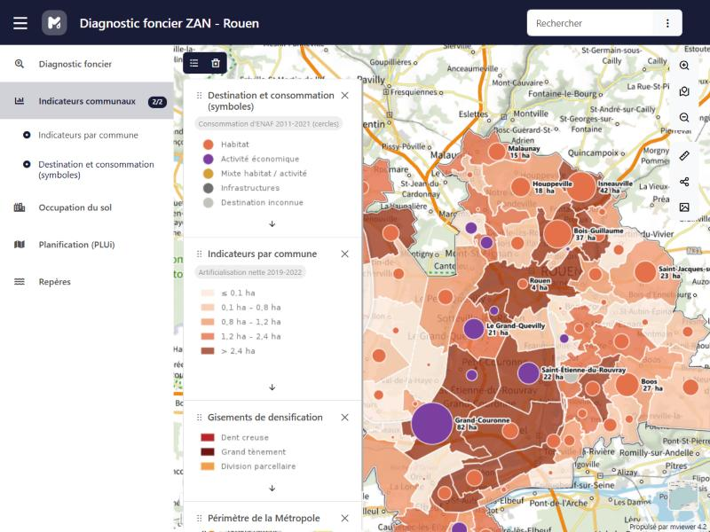
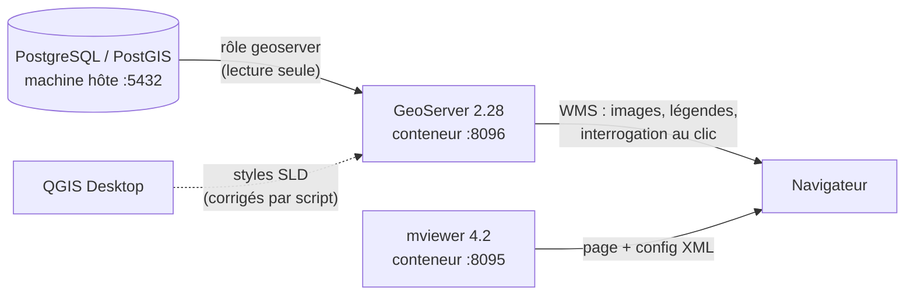
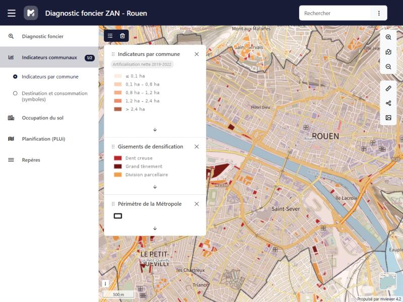

# mviewer + GeoServer + PostGIS avec Docker

Tutoriel pour publier des données **PostGIS** dans une carte web **[mviewer](https://github.com/mviewer/mviewer)**, en passant par **GeoServer**, avec des styles repris de **QGIS**.

Tout tourne en local avec Docker. PostgreSQL reste installé sur ta machine, comme d'habitude.



---

## Sommaire

1. [Principe](#1-principe)
2. [Prérequis](#2-prérequis)
3. [Installation](#3-installation)
4. [Publier une base PostGIS dans GeoServer](#4-publier-une-base-postgis-dans-geoserver)
5. [Reprendre les styles de QGIS](#5-reprendre-les-styles-de-qgis)
6. [Créer une application mviewer](#6-créer-une-application-mviewer)
7. [Commandes utiles](#7-commandes-utiles)
8. [Dépannage](#8-dépannage)
9. [Contenu du dépôt](#9-contenu-du-dépôt)

---

## 1. Principe

mviewer est une page web : **il ne lit pas PostGIS directement**. Il affiche des flux **WMS**, ici fournis par GeoServer, qui lit lui-même la base.



| Service   | Adresse                                        | Rôle                                   |
|-----------|------------------------------------------------|----------------------------------------|
| mviewer   | http://localhost:8095                          | visualiseur (fichiers statiques nginx) |
| GeoServer | http://localhost:8096/geoserver/web/           | serveur WMS/WFS, styles SLD            |
| PostGIS   | `host.docker.internal:5432` vu des conteneurs  | données                                |

Les ports ne sont ouverts que sur `127.0.0.1` : la pile n'est accessible que depuis ta machine.

## 2. Prérequis

- **Docker Desktop** (Windows, macOS) ou Docker Engine avec le plugin `compose` (Linux)
- **PostgreSQL 14 ou plus** avec **PostGIS**, installé sur la machine
- **bash** : sous Windows, *Git Bash* (installé avec [Git for Windows](https://git-scm.com/download/win)), qui fournit aussi `curl` et `openssl`
- **Python 3.8+** pour corriger les styles exportés de QGIS
- **QGIS** (facultatif) pour préparer les styles
- Ports **8095** et **8096** libres

> Les commandes `bash` ci-dessous se lancent **depuis la racine du dépôt**, dans Git Bash sous Windows.

## 3. Installation

### 3.1 Cloner le dépôt

```bash
git clone https://github.com/<ton-compte>/<ce-depot>.git
cd <ce-depot>
```

### 3.2 Générer les mots de passe

```bash
bash scripts/init-env.sh
```

Le script crée `.env` à partir de [`.env.example`](.env.example), avec deux mots de passe aléatoires :

- `GEOSERVER_ADMIN_PASSWORD` : compte `admin` de GeoServer ;
- `PG_GEOSERVER_PASSWORD` : rôle PostgreSQL qu'utilisera GeoServer.

`.env` est ignoré par git : il ne doit jamais être publié.

### 3.3 Créer le rôle PostgreSQL en lecture seule

GeoServer se connecte à PostGIS avec un rôle dédié qui peut **lire** mais pas **modifier**.

```bash
set -a; . ./.env; set +a
psql -h localhost -U postgres -d postgres -v pw="$PG_GEOSERVER_PASSWORD" -f scripts/creer-role-geoserver.sql
```

> Sous Windows, si `psql` n'est pas dans le PATH : `"/c/Program Files/PostgreSQL/15/bin/psql.exe"` (adapte la version).

Le rôle reçoit `pg_read_all_data` : lecture de toutes les tables de toutes les bases. Si une base refuse la connexion par défaut, ajoute pour elle :

```sql
GRANT CONNECT ON DATABASE ma_base TO geoserver;
```

<details>
<summary><b>Linux uniquement</b> : laisser les conteneurs joindre PostgreSQL</summary>

Avec Docker Desktop (Windows, macOS), `host.docker.internal` arrive sur PostgreSQL comme une connexion locale : rien à faire.

Sous Linux, les conteneurs arrivent par le réseau Docker (souvent `172.17.0.0/16` ou `172.18.0.0/16`) :

1. `postgresql.conf` : `listen_addresses = 'localhost,172.17.0.1'` (ou `'*'`)
2. `pg_hba.conf` : `host  all  geoserver  172.16.0.0/12  scram-sha-256`
3. redémarrer PostgreSQL.

</details>

### 3.4 Ajouter les polices des étiquettes (facultatif)

Les styles QGIS utilisent souvent **Segoe UI** (Windows). Pour que GeoServer dessine les étiquettes avec la même police, copie les `.ttf` dans `fonts/` :

```powershell
Copy-Item C:\Windows\Fonts\segoeui*.ttf .\fonts\
```

Les polices ne sont pas versionnées (licences propriétaires), voir [`fonts/LISEZMOI.md`](fonts/LISEZMOI.md).

### 3.5 Démarrer

```bash
docker compose up -d
```

Le premier démarrage télécharge les images (environ 1,7 Go, surtout GeoServer) puis GeoServer met une minute à démarrer. Vérifications :

- http://localhost:8095 affiche l'application de démonstration de mviewer ;
- http://localhost:8096/geoserver/web/ affiche GeoServer : connecte-toi avec `admin` et le mot de passe de `.env`.

## 4. Publier une base PostGIS dans GeoServer

```bash
bash scripts/publier-postgis.sh <base> [schéma=public] [espace_de_travail=<base>]
# exemple
bash scripts/publier-postgis.sh zan_rouen zan
```

Le script passe par l'API REST de GeoServer et :

1. crée l'**espace de travail** (nommé comme la base par défaut) ;
2. crée l'**entrepôt PostGIS** (`host.docker.internal:5432`, rôle `geoserver`) ;
3. publie **toutes les tables géométriques** du schéma qui ne le sont pas encore : relancer le script ne publie que les nouvelles.

Il affiche à la fin l'adresse du flux WMS à mettre dans mviewer :

```
WMS pour mviewer : http://localhost:8096/geoserver/zan_rouen/wms
```

Pour contrôler : GeoServer > *Prévisualisation de la couche* > OpenLayers.

Sans style, GeoServer dessine toutes les couches en gris : c'est l'objet de l'étape suivante.

## 5. Reprendre les styles de QGIS

GeoServer lit des styles **SLD**, que QGIS sait exporter. Mais l'export est imparfait. Ce dépôt fournit un script qui corrige les défauts mesurés en comparant, couche par couche, le rendu QGIS et le rendu GeoServer.

### 5.1 Exporter depuis QGIS

1. Donne à chaque couche un **nom court** : *Propriétés de la couche > QGIS Server > Nom court* (ex. `gisements`).
2. *Propriétés de la couche > Symbologie > Style* (en bas) *> Exporter le style > Format SLD…*
3. Enregistre-le dans `styles/export-qgis/<nom_court>.sld`.

### 5.2 Corriger les SLD

```bash
python scripts/corriger-sld.py chemin/vers/projet.qgz
```

Le script relit le projet QGIS (`.qgs` ou `.qgz`), part toujours de l'export brut et écrit la version corrigée dans `styles/<nom_court>.sld`. On peut le relancer autant de fois que nécessaire.

| Ce que l'export SLD de QGIS abîme | Effet dans GeoServer | Correction appliquée |
|---|---|---|
| Épaisseurs arrondies au 0,5 px (0,2 mm donne 1 px au lieu de 0,76 px) | traits trop épais | épaisseurs recalculées depuis le projet (1 mm = 3,78 px) |
| Traits de moins d'1 px | GeoServer les élargit à 1 px plein, trop sombres | 1 px avec une opacité égale à la largeur |
| Expressions `@map_scale` (ex. remplissage pâle quand on zoome) | perdues : rendu identique à toutes les échelles | traduites en `env('wms_scale_denominator')` |
| Motif Qt `dense6` | inconnu de GeoServer | semis de points équivalent |

**Ce que le script ne sait pas faire.** Les tailles, couleurs ou étiquettes calculées par expression (symboles proportionnels, couleurs « CASE WHEN », étiquettes composées) sont perdues à l'export. Il faut alors écrire le SLD à la main. Exemple complet : [`styles/conso_enaf_cercles.sld`](styles/conso_enaf_cercles.sld), avec des cercles proportionnels à la surface, une couleur par catégorie, les gros cercles dessous et des étiquettes sur deux lignes. Un fichier qui contient le texte `SLD manuel` n'est jamais écrasé par le script.

### 5.3 Associer les styles aux couches et importer

Déclare les associations dans [`styles/styles.conf`](styles/styles.conf), une ligne par couche :

```
# espace_de_travail | couche (= table) | style par défaut | styles alternatifs
zan_rouen|gisements_densification|gisements|
zan_rouen|communes_indicateurs|communes|ind_artif_nette,ind_conso_1121
```

Puis :

```bash
bash scripts/importer-styles.sh
```

Les styles alternatifs pourront être choisis dans mviewer (menu déroulant sous la légende).

## 6. Créer une application mviewer

Une application mviewer est un fichier **XML** dans `apps/`. Le dossier est monté dans mviewer sous `apps/perso/`.

### 6.1 Fichier minimal

`apps/ma_carte.xml` :

```xml
<?xml version="1.0" encoding="UTF-8"?>
<config>
    <application title="Ma carte" mouseposition="true" measuretools="true" exportpng="true"/>
    <mapoptions maxzoom="20" projection="EPSG:3857" center="122373,6350400" zoom="11"
        projextent="-20037508.342789244, -20037508.342789244, 20037508.342789244, 20037508.342789244"/>

    <baselayers style="gallery">
        <baselayer type="WMTS" id="planign" label="Plan IGN" title="IGN" thumbgallery="img/basemap/osm.png"
            url="https://data.geopf.fr/wmts" layers="GEOGRAPHICALGRIDSYSTEMS.PLANIGNV2" format="image/png"
            style="normal" matrixset="PM" maxzoom="19" fromcapacity="false" visible="true" attribution="IGN"/>
    </baselayers>

    <proxy url=""/>
    <olscompletion url="https://data.geopf.fr/geocodage/search" type="search" attribution="IGN - BAN"/>
    <searchparameters bbox="false" localities="true" features="false"/>

    <themes>
        <theme name="Mes données" id="donnees" collapsed="false" icon="fas fa-layer-group">
            <layer id="gisements_densification" name="Gisements de densification"
                url="http://localhost:8096/geoserver/zan_rouen/wms"
                visible="true" tiled="false" queryable="true"
                infoformat="application/vnd.ogc.gml" featurecount="5"/>
        </theme>
    </themes>
</config>
```

`center` est en EPSG:3857 (mètres). Pour le trouver : dans QGIS, passe le SCR du projet en EPSG:3857 et lis les coordonnées du centre voulu dans la barre d'état.

Ouvre ensuite http://localhost:8095/?config=apps/perso/ma_carte.xml

### 6.2 Attributs utiles d'une couche `<layer>`

| Attribut | Rôle |
|---|---|
| `id` | **nom de la couche dans GeoServer** (= nom de la table), sans préfixe si l'URL vise l'espace de travail |
| `name` | libellé affiché dans mviewer |
| `url` | flux WMS de l'espace de travail : `http://localhost:8096/geoserver/<espace>/wms` |
| `queryable` + `infoformat` | interrogation au clic ; `application/vnd.ogc.gml` donne une fiche attributaire propre |
| `style` + `stylesalias` + `styletitle` | plusieurs styles GeoServer au choix (noms, libellés, titre du menu) |
| `tiled` | `true` : requêtes en tuiles, plus rapide sur les grosses couches ; `false` : une seule image, mieux pour les étiquettes |
| `scalemin` + `scalemax` | plage d'échelles d'affichage, **toujours les deux** (voir [Dépannage](#8-dépannage)) |
| `visible` | couche affichée au chargement |

Exemple complet avec 5 thèmes, 13 couches et des styles au choix : [`apps/zan_rouen.xml`](apps/zan_rouen.xml). Il nécessite la base `zan_rouen`, non fournie.



Documentation complète du XML : [mviewerdoc.readthedocs.io](https://mviewerdoc.readthedocs.io/fr/latest/).

## 7. Commandes utiles

```bash
docker compose up -d                 # démarrer (les conteneurs redémarrent ensuite avec Docker)
docker compose down                  # arrêter
docker compose restart geoserver     # après ajout de polices
docker compose logs -f geoserver     # journal de GeoServer
docker compose pull && docker compose up -d   # mettre à jour les images
docker compose down -v               # tout supprimer, y compris la configuration GeoServer (volume)
```

La configuration de GeoServer (espaces de travail, entrepôts, styles) vit dans le volume Docker `mviewer_geoserver_data`. Après un `down -v`, relance les étapes 4 et 5.

## 8. Dépannage

| Symptôme | Cause | Solution |
|---|---|---|
| Couche jamais dessinée, œil barré dans la légende | `scalemax` sans `scalemin` : mviewer teste `échelle >= scalemin`, toujours faux si `scalemin` est absent | mettre les deux : `scalemin="0" scalemax="25000"` |
| Toutes les couches en gris | aucun style importé (style par défaut de GeoServer) | [étape 5](#5-reprendre-les-styles-de-qgis) |
| Traits plus épais ou plus foncés que dans QGIS | SLD brut, non corrigé | `python scripts/corriger-sld.py projet.qgz` puis `importer-styles.sh` |
| Symboles proportionnels absents, étiquettes « Placeholder » | expressions QGIS perdues à l'export | écrire le SLD à la main (voir `conso_enaf_cercles.sld`) |
| `droit refusé pour la base` / `permission denied for database` | la base n'accorde pas `CONNECT` | `GRANT CONNECT ON DATABASE ma_base TO geoserver;` |
| GeoServer n'arrive pas à joindre PostgreSQL (Linux) | PostgreSQL n'écoute que sur `localhost` | voir l'encadré Linux de l'[étape 3.3](#33-créer-le-rôle-postgresql-en-lecture-seule) |
| Clic sur la carte sans résultat | couche non `queryable`, ou CORS | `queryable="true"` ; CORS est déjà ouvert pour `localhost:8095` dans `docker-compose.yml` |
| Étiquettes dans une autre police | police absente de `fonts/` | copier le `.ttf`, puis `docker compose restart geoserver` |
| Port 8095 ou 8096 déjà utilisé | autre service sur le port | changer la partie gauche de `ports:` dans `docker-compose.yml` (et les URL des XML) |
| Modification de XML ou de style invisible | cache du navigateur | **Ctrl+F5** |
| Couches un peu floues sur un écran à 125 ou 150 % | mviewer ne demande pas d'images haute densité au serveur WMS | limite de mviewer, sans réglage dans le XML |

## 9. Contenu du dépôt

```
.
├── docker-compose.yml          # conteneurs mviewer (8095) et GeoServer (8096)
├── .env.example                # modèle de configuration (copié en .env, non versionné)
├── apps/                       # applications mviewer (XML) -> apps/perso/ dans mviewer
│   └── zan_rouen.xml           # exemple complet
├── styles/
│   ├── export-qgis/            # SLD bruts exportés de QGIS (jamais modifiés)
│   ├── *.sld                   # SLD corrigés, importés dans GeoServer
│   └── styles.conf             # association couche -> styles
├── scripts/
│   ├── init-env.sh             # crée .env avec des mots de passe aléatoires
│   ├── creer-role-geoserver.sql  # rôle PostgreSQL en lecture seule
│   ├── publier-postgis.sh      # publie les tables d'une base dans GeoServer
│   ├── corriger-sld.py         # corrige les SLD exportés de QGIS
│   └── importer-styles.sh      # importe les styles et les associe aux couches
├── fonts/                      # polices pour les étiquettes (non versionnées)
└── docs/                       # captures d'écran du tutoriel
```

---

### Sécurité

Cette pile est prévue pour un **usage local** : ports sur `127.0.0.1`, rôle PostgreSQL en lecture seule, secrets dans `.env` non versionné. Pour l'exposer sur un réseau, il faut au minimum un reverse proxy en HTTPS, un mot de passe administrateur GeoServer fort, et restreindre `CORS_ALLOWED_ORIGINS` au domaine réel.

### Crédits

- [mviewer](https://github.com/mviewer/mviewer) : GéoBretagne et contributeurs (GPL-3.0)
- [GeoServer](https://geoserver.org) et son [image Docker officielle](https://github.com/geoserver/docker) (GPL-2.0)
- [PostGIS](https://postgis.net) (GPL-2.0)
- Fonds de carte et géocodage : [Géoplateforme IGN](https://geoservices.ign.fr/)
